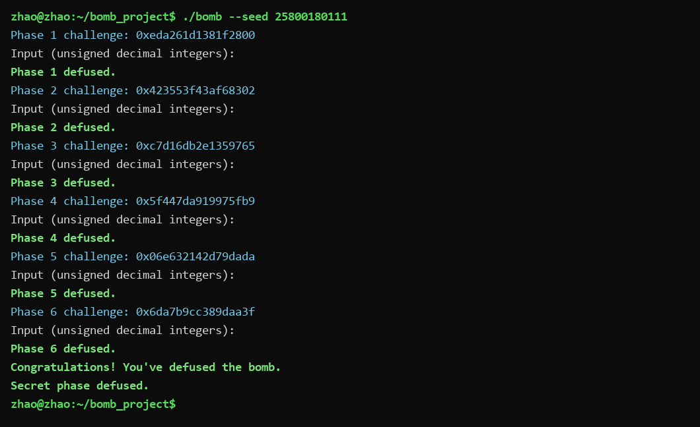
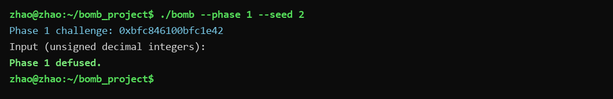
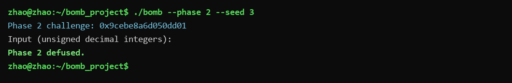
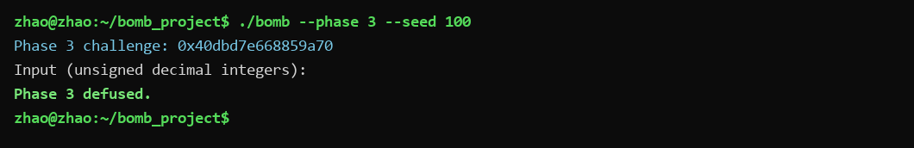
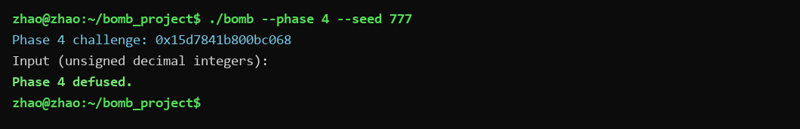
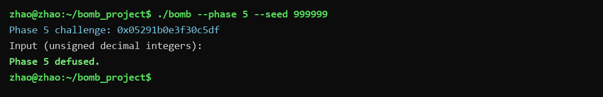
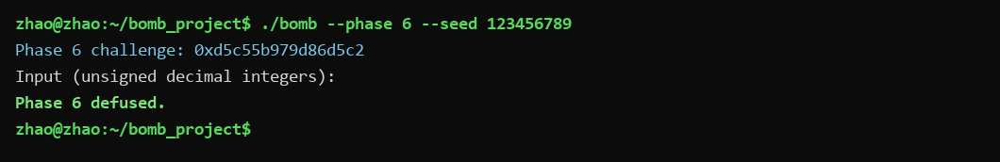
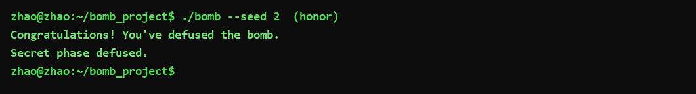

# BombLab 2026 实验报告

## 一、实验概述

- **环境**：Windows 11 + WSL2（Ubuntu，x86-64），GCC、GNU Make、Python 3、GDB、objdump。
- **方法**：先用 `objdump -d` 对 `bomb` 做离线反汇编，阅读各关卡函数及它们调用的辅助函数，恢复出对**任意 challenge 都成立的计算关系**；再用 GDB 设断点、查看寄存器与内存，验证从汇编读出的推测；最后把通用算法写进 `defuser.c`。
- **关键约定**：
  - 每关输入的整数都是 **32 位无符号整数（`uint32_t`）**，不是 64 位；32 位加、减、乘都按模 2³² 回绕。
  - 关卡入口 `rdi` 指向输入字符串，`rsi` 是 64 位 challenge。
  - 提交的是**从 challenge 算口令的算法**，不是某次运行的固定密码。

下文 `C` 表示 challenge，`>>`、`&`、`^`、`+`、`*` 均为 32 位无符号运算（取数时按需要截断）。

---

## 二、Phase 1 —— 维护站（函数调用、参数传递、返回值）

**考点**：把一个 64 位 challenge 拆成高/中/低三段，通过三个带返回值的子函数串起来。

`phase_01` 先用 `sscanf` 读入 **1 个**整数（格式串地址 `0x403189`，即 `"%u"`），再调用 `p1_compute`，最后 `cmp %eax,-0x14(%rbp)` 比较。

`p1_compute`（`0x402050`）从 `rdi` 中拆出三段：
- `hi = C >> 32`（`shr $0x20`）
- `mid = C >> 16`（`shr $0x10`）
- `lo = C & 0xffffffff`

三个子函数的关键指令：

```asm
p1_step1(hi, mid):  lea 0xeff0(%rsi),%eax ; xor %edi,%eax   ; (mid+0xeff0) ^ hi
p1_step0(lo, hi):   xor $0xae7,%esi       ; lea (%rsi,%rdi,2),%eax ; (hi^0xae7)+2*lo
p1_step2(r0, r1):   sub %esi,%edi         ; lea 0xe9(%rdi,%rdi,4),%eax ; 5*(r0-r1)+0xe9
```

**恢复的计算关系**：

```
r1 = (mid + 0xeff0) ^ hi
r0 = (hi ^ 0xae7) + 2*lo
answer = 5*(r0 - r1) + 0xe9
```

**推理**：`p1_compute` 先算 `p1_step1` 得到 `r1`，再算 `p1_step0` 得到 `r0`，最后 `p1_step2` 用 `r0 - r1` 乘以 5 加 `0xe9`。三个 `lea` 分别实现了 `x+2x`、`x+4x` 等乘法，是典型的用 `lea` 做常数乘法。

---

## 三、Phase 2 —— 钟楼（数组、循环、递推关系）

**考点**：读入 **6 个**整数，第一个由 challenge 直接给出，后 5 个由前一个递推得到。

`phase_02`（`0x4020f0`）用 `sscanf` 读 6 个整数（`cmp $0x6,%eax`）。

**第一个数**（`0x40215a` 起）：

```asm
mov %r13,%rax ; shr $0x11,%rax ; add %eax,%eax ; movzbl %al,%eax ; add $0x1,%eax
```

即 `v0 = (2*(C >> 17) & 0xff) + 1`。

**循环体**（`0x40217a` 起，`edx` 从 1 到 5，`ecx` 每次加 5）：

```asm
lea (%rsi,%rsi,2),%esi   ; 3 * 前一个数
mov %r13,%rax ; shr %cl,%rax ; and $0x3f,%eax ; add %edx,%eax ; xor %esi,%eax
```

第 k 轮移位量 `ecx = 25 + 5*(k-1) = 20 + 5k`。

**恢复的计算关系**：

```
v0 = (2*(C >> 17) & 0xff) + 1
对 k = 1..5:
    g = (C >> (20 + 5*k)) & 0x3f
    vk = (g + k) ^ (3 * v{k-1})
```

**推理**：循环把上一个数乘 3（`lea x+2x`），再与"challenge 中取出的 6 位常量 `g` 加上下标 `k`"异或，形成一个 5 步递推链。

---

## 四、Phase 3 —— 分流站（switch 分支与跳转表）

**考点**：读入 **2 个**整数；第一个数从 challenge 低 3 位选 8 个分支之一，第二个数由该分支的函数计算。

`phase_03`（`0x4022c0`）：
- `v0 = C & 7`（`and $0x7`）
- `x = (C >> 32) ^ (C >> 3)`（`mov %r13,%rax ; shr $0x20,%rax ; ... xor`）

`p3_dispatch`（`0x402260`）先 `cmp $0x7` 做边界检查，再用跳转表 `jmp *0x405820(,%rax,8)`。8 个 case 函数：

```asm
case0: lea 0x13fd(x,4x)          ; 5x + 0x13fd
case1: lea 0x0(,x,4) ; xor 0x368b ; 4x ^ 0x368b
case2: (x ^ 0x837f) + (x >> 2)
case3: lea 0x32cf8(x,4x)         ; 5x + 0x32cf8
case4: (x ^ 0x4d8) + (x >> 1)
case5: lea 0x0(,x,4) ; xor 0xc764 ; 4x ^ 0xc764
case6: lea 0x6a84(x,2x)          ; 3x + 0x6a84
case7: lea 0x3156a(x,4x)         ; 5x + 0x3156a
```

**关键**：跳转表 `0x405820` 里的 thunk 与 case 编号是**乱序**的，逐项读出表项后映射为：

```
jump_table 索引顺序 = [case3, case6, case7, case4, case0, case2, case5, case1]
```

**恢复的计算关系**：

```
v0 = C & 7
x  = (C >> 32) ^ (C >> 3)
v1 = 上表[v0] 对应的 case 函数(x)
```

**推理**：这是标准的跳转表实现 switch，但表项顺序不等于 case 编号，必须按表中实际指针排列，不能想当然按 0~7 顺序写。

---

## 五、Phase 4 —— 档案馆（递归调用与返回过程）

**考点**：读入 **1 个**整数；在区间 `[0, 0x7f]` 上做一次带"混淆"的二分查找递归。

`phase_04`（`0x4023b0`）准备参数：
- `target = C & 0x7f`（`and $0x7f,%edi`）
- `rcx = (C >> 7) ^ (C >> 32)`（`shr $0x7` 后与高 32 位异或）

然后调用 `p4_walk(target, 0, 0x7f, rcx)`（`0x402340`）。

`p4_walk` 先算中点 `mid = lo + (hi - lo)/2`（`sub ; shr ; add`）：

```asm
; 命中
target == mid:  lea 0xf8(%rdi),%eax ; xor %ecx,%eax          ; (mid+0xf8) ^ rcx
; 走左半 [lo, mid-1]
target < mid:   call walk ; lea (x,2x) ; xor pivot ; xor 0x3  ; 3*child ^ pivot ^ 0x3
; 走右半 [mid+1, hi]
target > mid:   call walk ; lea (x,2x) ; xor pivot ; xor 0x1d ; 3*child ^ pivot ^ 0x1d
```

其中 `pivot = mid + rcx`（`lea (%rdi,%rcx,1)`）。

**恢复的计算关系**：

```
walk(target, lo, hi, rcx):
    mid = lo + (hi - lo)/2
    若 target == mid: return (mid + 0xf8) ^ rcx
    若 target < mid:
        child = walk(target, lo, mid-1, rcx)
        return (3*child) ^ (mid+rcx) ^ 0x3
    否则:
        child = walk(target, mid+1, hi, rcx)
        return (3*child) ^ (mid+rcx) ^ 0x1d
```

**推理**：递归本身是普通二分，但每层返回时都把结果乘 3 并与 `mid+rcx`、一个左右不同的常量（`0x3` / `0x1d`）异或，因此不能直接返回 `target`，必须按递归路径逐层还原。

---

## 六、Phase 5 —— 巡检回廊（结构体布局、指针、链表遍历）

**考点**：读入 **2 个**整数；在一张静态链表（12 个节点）上从指定起点走指定步数，沿途做累加。

`phase_05`（`0x4024a0`）：
- `depth = (C >> 3) & 3`（`shr $0x3 ; and $0x3`）
- `start = heads[C & 7]`
- `acc = (C >> 6) ^ (C >> 32)`（`shr $0x6` 后异或高 32 位）

每个节点是 16 字节结构：`next`（指针，偏移 0）、`a`（偏移 8）、`b`（偏移 0xc）。

头节点表 `p5_heads`（`0x405b60`）逐项读出：

```
heads = [6, 3, 1, 8, 5, 7, 4, 9]   （元素为节点下标）
```

12 个节点（下标 0~11，字段为 `next, a, b`）：

```
{11,0x351,0xd003} {8,0x885,0x40f1} {10,0x166,0x7b25} {1,0x472,0xc718}
{9,0x61b,0xf0c2}  {7,0x51d,0xeea0} {3,0x003,0xc6b4}  {4,0xa15,0x22b2}
{5,0xb30,0x2494}  {0,0x73b,0xf511} {-1,0x23c,0xd896} {2,0x938,0x476b}
```

每访问一个节点（`p5_traverse`，`0x402430`）：

```asm
xor $0x3e4e,%eax ; add 0xc(%rdx),%eax ; lea (x,4x),%eax ; xor 0x8(%rdx),%eax
mov 0x8(%rdx),(%r8)   ; 记录最后一个节点的 a
```

**恢复的计算关系**：

```
acc = (C >> 6) ^ (C >> 32)
node = heads[C & 7]
重复 depth 次（含起点共 depth+1 个节点）:
    acc ^= 0x3e4e
    acc += node.b
    acc *= 5
    acc ^= node.a
    记录 node.a，node = node.next
输出 [acc, 最后一个节点的 a]
```

**推理**：起点和深度都由 challenge 的不同位段决定；每节点固定做"异或常量 → 加 b → 乘 5 → 异或 a"四步，第二个输出是遍历结束时最后一个节点的 `a`。

---

## 七、Phase 6 —— 交接室（函数指针表与间接调用）

**考点**：读入 **1 个**整数；从函数指针表中两次间接调用，且两次选的操作不同。

`p6_dispatch`（`0x402580`）：
- `x0 = (C >> 6) ^ (C >> 32)`
- `i1 = C & 7`
- `i2 = (C & 0x38) >> 3`

6 个操作函数（`p6_op_0`~`p6_op_5`）：

```
op0: (x ^ 0xd09) + 4x
op1: (4x + 0x990b) ^ 3x
op2: ror32(x, 1)
op3: ((x >> 1) ^ x) + 0x1335
op4: rol32(x, 2) ^ 0xbf77
op5: (x + 0x4995) ^ (x >> 3)
```

函数指针表 `p6_ops`（`0x405e00`）逐项读出：

```
p6_ops = [op1, op5, op4, op0, op5, op2, op1, op3]
```

**恢复的计算关系**：

```
x1 = p6_ops[i1](x0) ^ 0xf56b
x2 = p6_ops[i2](x1)
answer = x2 + 0x71c7
```

**推理**：第一次调用后还异或了 `0xf56b`，第二次调用后加 `0x71c7`；两个下标分别来自 challenge 的不同位段，表中存在重复项（`op1`、`op5` 各出现两次）。

---

## 八、Honor —— Secret phase（必做）

**考点**：综合运用长度/魔数校验、缓冲区布局和三数运算。

`secret_gate`（`0x402720`）流程：
1. 在栈上开 163 字节缓冲区并清零。
2. 长度检查：`strlen(input) - 0x24 <= 0x7f`，即长度必须在 **36~163** 之间。
3. 用 `secret_copy`（即 `strcpy`）把输入复制到缓冲区。
4. 检查缓冲区**偏移 32** 处的 4 字节是否为 `0x4e45504f`（小端，即 ASCII `"OPEN"`）：`cmpl $0x4e45504f,-0xb0(%rbp)`。
5. 用缓冲区**偏移 36** 处的子串调用 `secret_phase`。

**输入布局**：

```
[0..31]  任意 32 字节前缀（不含 '\0'）
[32..35] "OPEN"
[36..]   三个无符号整数
```

`secret_phase`（`0x402640`）读入 3 个 `u32`，参数为 `challenge`（`r12`）和 `context`（`r13`，由前六行口令得到）。关键指令：

```asm
v0 = context & 3                       ; and $0x3
S  = (challenge>>32) ^ (challenge)     ; 高 32 位异或低 32 位
R  = (context>>32) ^ (context)
T  = (v0*0x42f7) ^ (context>>16)
U  = secret_mix(S ^ R)                 ; secret_mix(x)=ror32(x,5)^0x5b85
```

**恢复的计算关系**：

```
v0 = context & 3
S  = (challenge>>32) ^ (challenge & 0xffffffff)
R  = (context>>32)   ^ (context & 0xffffffff)
T  = (v0 * 0x42f7) ^ (context >> 16)
U  = ror32(S ^ R, 5) ^ 0x5b85
v1 = U ^ T
v2 = (U ^ T) ^ (R + v0 + 0x1972 + (S >> 5))
```

**推理**：`"OPEN"` 不是在输入开头，而是在 32 字节前缀之后；前缀本身不被检查，但必须存在（否则偏移 32 处对不上、长度也不够）。三个数中 `v0` 只由 `context` 低 2 位决定，`v1` 由 `U`、`T` 组合，`v2` 再在 `v1` 基础上异或一个含 `R`、`v0`、`S>>5` 的量。

---

## 九、非公开 seed 验证记录

公开 seed 为 `tests/public.json` 中的 `0,1,7,42,99,123,2026,65535,987654321,18446744073709551615`。每个关卡另外用**公开列表之外**的 seed 单独验证：

| 关卡 | 验证用 seed | 结果 |
|------|-------------|------|
| Phase 1 | 2 | `Phase 1 defused.` |
| Phase 2 | 3 | `Phase 2 defused.` |
| Phase 3 | 100 | `Phase 3 defused.` |
| Phase 4 | 777 | `Phase 4 defused.` |
| Phase 5 | 999999 | `Phase 5 defused.` |
| Phase 6 | 123456789 | `Phase 6 defused.` |
| Secret | 2 | `Secret phase defused.` |
| 完整 7 行（个人 seed） | 25800180111 | 6 关 + Secret 全部 defused |

此外还对 seed `0`、`100`、`777`、`999999`、`123456789`、`18446744073709551615` 等做了完整端到端验证，均通过。

---

## 十、运行结果截图

完整运行（个人 seed 25800180111，6 关 + Congratulations + Secret）：



各关卡单独验证：

 

 

 

Secret 验证：



---

## 十一、使用的辅助工具与参考资料

- **objdump**：对 `bomb` 做离线反汇编，阅读各关函数与辅助函数。
- **GDB**：设断点、单步（`si/ni`）、查看寄存器（`i r`）和内存（`x`），核对从汇编读出的公式；**未使用 `set` 修改任何程序数据**。
- **GCC / Make**：以 `-Wall -Wextra -Werror` 编译 `defuser.c`。
- **AI 辅助说明**：在课程允许范围内，用 AI 辅助理解个别指令含义、检查 32 位回绕是否处理正确、整理报告结构；所有公式均由本人读汇编得到，并通过 GDB 与多 seed 运行验证，AI 生成的内容没有直接作为自己的分析或答案提交。
- 参考资料：CSAPP《深入理解计算机系统》第三章；课程实验文档与 `tutor/` 教学示例。
